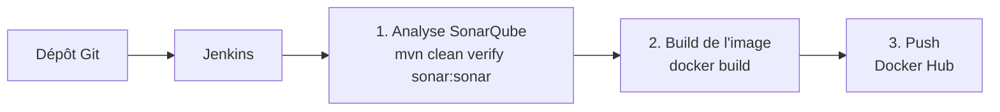

<div align="center">

# 🐳 Docker : Pipeline CI/CD Jenkins pour une application Java

**Pipeline d'intégration et de livraison continues : analyse de la qualité du code avec SonarQube, construction d'une image Docker multi-étapes et publication sur Docker Hub, le tout orchestré par Jenkins.**

</div>

---

## 📑 Sommaire

- [Présentation](#-présentation)
- [Contenu du dépôt](#-contenu-du-dépôt)
- [Le pipeline CI/CD](#-le-pipeline-cicd)
- [L'image Docker](#-limage-docker)
- [Prérequis](#-prérequis)
- [Configuration de Jenkins](#-configuration-de-jenkins)
- [Utilisation](#-utilisation)
- [État actuel du projet](#-état-actuel-du-projet)
- [Pistes d'amélioration](#-pistes-damélioration)
- [Auteur](#-auteur)

---

## 🎯 Présentation

Ce dépôt met en place une chaîne **CI/CD** pour un projet **Java 17 / Maven** :

1. **Analyse statique** du code avec **SonarQube**,
2. **Construction** d'une image **Docker** de l'application,
3. **Publication** de l'image sur **Docker Hub** (`zakariazammouri/docker:latest`).

Les trois étapes sont décrites dans un `Jenkinsfile` (pipeline déclaratif) et s'exécutent automatiquement à chaque lancement du job Jenkins.

---

## 📦 Contenu du dépôt

| Fichier | Rôle |
|---|---|
| `Jenkinsfile` | Pipeline Jenkins en trois étapes (SonarQube, build Docker, push Docker Hub) |
| `Dockerfile` | Construction multi-étapes de l'image : compilation Maven puis exécution sur un JDK 17 |
| `pom.xml` | Descripteur Maven du projet (`com.example:docker:1.0-SNAPSHOT`, packaging `jar`) |
| `README.md` | Ce document |

---

## 🔄 Le pipeline CI/CD



| Étape | Ce qu'elle fait |
|---|---|
| **SonarQube Analysis** | Exécute `mvn clean verify sonar:sonar` et envoie les résultats au serveur SonarQube (`http://localhost:9000`, projet `docker`). Le jeton est lu depuis l'identifiant Jenkins `sonar-token`. |
| **Build Docker Image** | Construit l'image `zakariazammouri/docker:latest` à partir du `Dockerfile`. |
| **Push to DockerHub** | Se connecte à Docker Hub avec l'identifiant Jenkins `dockerHub`, puis publie l'image. |

---

## 🐋 L'image Docker

Le `Dockerfile` utilise un **build multi-étapes** pour obtenir une image finale plus légère que l'image de compilation :

| Étape | Image de base | Rôle |
|---|---|---|
| **build** | `maven:3.9.9-eclipse-temurin-17` | Copie le `pom.xml`, télécharge les dépendances (`mvn dependency:go-offline`, ce qui profite du cache des couches Docker), puis compile et empaquette le projet (`mvn clean package -DskipTests`). |
| **runtime** | `eclipse-temurin:17-jdk-jammy` | Récupère uniquement le `.jar` produit, expose le port **8080** et lance `java -jar app.jar`. |

---

## ✅ Prérequis

- **Jenkins** avec un agent disposant de **Maven**, **JDK 17** et **Docker**
- Un serveur **SonarQube** accessible sur `http://localhost:9000`
- Un compte **Docker Hub**
- Les plugins Jenkins *Pipeline* et *Credentials Binding*

---

## ⚙️ Configuration de Jenkins

Deux identifiants doivent être créés dans Jenkins (*Manage Jenkins → Credentials*) :

| ID | Type | Contenu |
|---|---|---|
| `sonar-token` | Secret text | Jeton d'accès généré dans SonarQube |
| `dockerHub` | Username with password | Identifiants du compte Docker Hub |

Crée ensuite un job de type **Pipeline** (ou *Multibranch Pipeline*) qui pointe vers ce dépôt : Jenkins détectera automatiquement le `Jenkinsfile` à la racine.

---

## 🚀 Utilisation

### Via Jenkins

Lance le job : les trois étapes s'enchaînent et l'image est publiée sur Docker Hub.

### En local

```bash
# Construire l'image
docker build -t zakariazammouri/docker:latest .

# Lancer un conteneur
docker run -p 8080:8080 zakariazammouri/docker:latest
```

---

## 📌 État actuel du projet

Ce dépôt contient l'**infrastructure CI/CD**. Le code applicatif Java n'y est pas encore présent :

- le dossier `src/` n'existe pas, alors que le `Dockerfile` le copie (`COPY src ./src`) ;
- le `pom.xml` est minimal : il ne déclare ni dépendances, ni version de Java, ni classe principale.

Pour que le pipeline aille jusqu'au bout, il faut donc ajouter le code source de l'application dans `src/` et compléter le `pom.xml`.

---

## 🔭 Pistes d'amélioration

- Ajouter le code source de l'application et compléter le `pom.xml` (dépendances, version de Java, plugin d'empaquetage exécutable).
- Utiliser `docker login --password-stdin` plutôt que `-p` dans le `Jenkinsfile`, pour ne pas exposer le mot de passe dans la ligne de commande.
- Étiqueter l'image avec le numéro de build (`BUILD_NUMBER`) en plus de `latest`.
- Ajouter un fichier `.dockerignore` et des tests automatisés.
- Utiliser une image JRE pour l'exécution afin de réduire la taille de l'image finale.

---

## 👤 Auteur

**Zakaria Zammouri** : étudiant en Génie Informatique (Full Stack & IA)

GitHub : [@Zakaria-Zammouri](https://github.com/Zakaria-Zammouri)

---

<div align="center">
<sub>Jenkins · SonarQube · Docker · Maven</sub>
</div>
